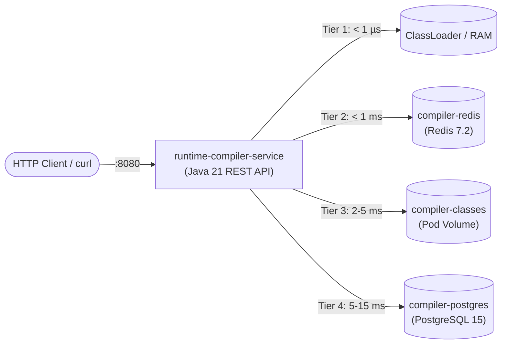
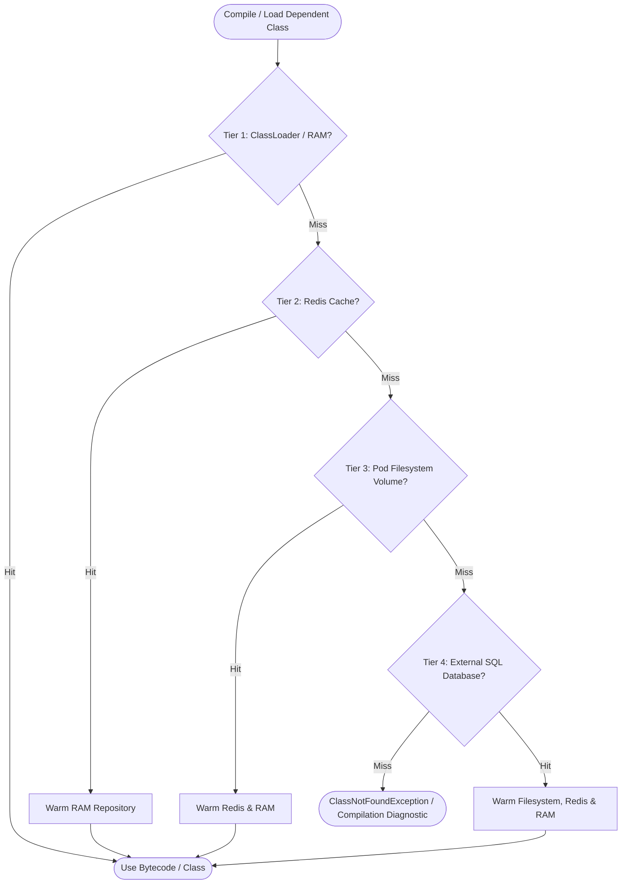

# RuntimeCompile

A high-performance, in-memory Java runtime compilation, JIT execution, and bytecode synthesis engine. It enables
compiling and executing dynamic Java code, scripts, and expressions entirely in RAM with zero disk I/O, sub-millisecond
caching, robust multi-tier dependency resolution, containerized microservices, and sandboxed security.

---

## ⚡ Quick Start

### Prerequisites

- **Java 17 or 21+** (The included Gradle Wrapper automatically provisions a JDK if missing).
- **Podman 4.x/5.x** or **podman-compose** (for containerized service deployment).

### Build and Run

```bash
# 1. Run the application and multi-engine demonstration
./gradlew run --quiet

# 2. Run all tests (74 tests)
./gradlew test

# 3. Clean and build distribution binaries
./gradlew installDist
```

---

## 🚀 Key Features

* **Zero Interface or Base Class Coupling**: The API is completely generic and class-independent. There is no
  requirement to implement or extend any specific interface or base class. Compile arbitrary standalone classes,
  records, enums, interfaces, or domain services.
* **Minimal Input API**: Pass **only the source code** (`compiler.compile(sourceCode)`). Package and class declarations
  are auto-inferred. Also supports direct compilation from `Path` or `File`.
* **Containerized Microservice**: Package and start as a production-grade service in Podman with REST API endpoints
  (`/api/compile`, `/api/execute`, `/api/health`, `/api/tiers`, `/api/bytecode`, `/api/classes`).
* **Multi-Engine REST Compiler Selection**: Clients can choose their compiler engine (`JAVAC`, `JANINO`, `GROOVY`)
  dynamically per request via JSON body, query parameter, or HTTP header.
* **Bytecode Distribution to Client Systems**: Remote client systems can load compiled classes directly into their own
  ClassLoaders via standard `URLClassLoader`, Base64 JSON response, or raw binary `.class` streams.
* **Multi-Tier Storage & Resolution Hierarchy**:
  Dynamically persists compiled classes and resolves dependent classes across a 4-tier chain based on availability:
  $$\mathbf{ClassLoader / RAM} \longrightarrow \mathbf{Redis\ (In\text{-}Memory\ Cache)} \longrightarrow \mathbf{Filesystem\ (Pod\ Local)} \longrightarrow \mathbf{External\ DB\ (Container\ SQL)}$$
    * Automatically warms upper tiers (Redis, RAM) whenever a class is loaded from lower tiers (Filesystem, DB).
* **Cross-Class In-Memory Linking**: Dependent classes compiled in earlier steps in RAM are automatically visible to
  subsequent compilations and can be linked and invoked at runtime without disk writes.
* **Batch Compilation**: Compile mutually or circularly dependent classes in a single compiler task via
  `compiler.compileBatch(sourcesMap)`.
* **Dynamic Invocation Helpers**: Execute dynamic classes effortlessly using `result.invoke(...)`,
  `result.invokeStatic(...)`, `result.invokeOn(...)`, and `result.newInstance(args...)` without reflection boilerplate.
* **Enterprise Security & Sandboxing**: AST-level lexical rules blocking forbidden APIs (e.g., `Runtime.getRuntime`,
  `ProcessBuilder`, `System.exit`, reflection, unauthorized network/file I/O) and execution timeouts via
  `SandboxedExecutor`.
* **Multi-Engine JIT Ecosystem**: Includes Janino, Byte Buddy, Javassist, Groovy `@CompileStatic`, and MVEL engines.

---

## 🦭 Running as a Service in Podman Containers

`RuntimeCompile` runs as a containerized REST microservice orchestrated alongside Redis and PostgreSQL containers using
Podman.



### 1. Build and Start via Podman Pod Script (Recommended)

Run the included automated launch script:

```bash
# 1. Build the distribution and container image
./gradlew installDist
podman build -t runtime-compile:latest -f deploy/containers/Dockerfile .

# 2. Launch the Podman Pod (includes PostgreSQL, Redis, and Compiler Service)
./deploy/scripts/podman-run.sh
```

To stop and clean up the pod and containers:

```bash
./deploy/scripts/podman-stop.sh
```

---

### 2. Start via `podman-compose`

Alternatively, deploy using the included `podman-compose.yml`:

```bash
# Start all containers in the background
podman-compose -f deploy/containers/podman-compose.yml up -d

# Check running services
podman-compose -f deploy/containers/podman-compose.yml ps

# View service logs
podman-compose -f deploy/containers/podman-compose.yml logs -f compiler-service

# Stop all containers
podman-compose -f deploy/containers/podman-compose.yml down
```

---

### 3. Container Configuration & Environment Variables

| Variable           | Default Value                                  | Description                                                         |
|:-------------------|:-----------------------------------------------|:--------------------------------------------------------------------|
| `SERVER_PORT`      | `8080`                                         | HTTP port exposed by the microservice.                              |
| `COMPILER_SERVICE` | `true`                                         | When `true` or `--server`, starts HTTP server instead of CLI suite. |
| `STORAGE_DIR`      | `/var/data/compiler/classes`                   | Path for Tier 3 local filesystem volume storage.                    |
| `REDIS_HOST`       | `localhost` / `redis`                          | Hostname or IP of the Tier 2 Redis cache container.                 |
| `REDIS_PORT`       | `6379`                                         | Port of the Redis cache container.                                  |
| `REDIS_PASSWORD`   | *(empty)*                                      | Optional authentication password for Redis.                         |
| `DB_URL`           | `jdbc:postgresql://localhost:5432/bytecode_db` | JDBC connection URL for Tier 4 SQL database.                        |
| `DB_USER`          | `compiler_user`                                | SQL database user.                                                  |
| `DB_PASSWORD`      | `compiler_pass`                                | SQL database password.                                              |

---

### 4. REST API Endpoints & `curl` Examples

#### REST API Endpoints Overview

| Endpoint                           | Method | Input Format        | Output Format                | Description                                                                |
|:-----------------------------------|:-------|:--------------------|:-----------------------------|:---------------------------------------------------------------------------|
| `/api/health`                      | `GET`  | -                   | JSON                         | Health status, uptime, and version.                                        |
| `/api/tiers`                       | `GET`  | -                   | JSON                         | Availability and metrics for all 4 storage tiers.                          |
| `/api/compile`                     | `POST` | JSON / `text/plain` | JSON (with Base64 bytecode)  | Compiles code in RAM using chosen compiler and returns bytecode.           |
| `/api/execute`                     | `POST` | JSON                | JSON                         | Invokes a method dynamically on the server without reflection boilerplate. |
| `/api/bytecode/{className}`        | `GET`  | Path variable       | Binary stream or Base64 JSON | Downloads raw `.class` binary bytecode or Base64 for a class.              |
| `/api/classes/{pkg}/{Class}.class` | `GET`  | URL path            | `application/java-vm-type`   | Serves `.class` streams for standard Java `URLClassLoader`.                |

---

#### A. Health Check (`GET /api/health`)

```bash
curl -s http://localhost:8080/api/health
```

**Response (200 OK):**

```json
{
  "status": "UP",
  "uptimeMs": 42100,
  "version": "1.0.0"
}
```

---

#### B. Storage Tiers Status (`GET /api/tiers`)

```bash
curl -s http://localhost:8080/api/tiers
```

**Response (200 OK):**

```json
{
  "tier1_classloader": {
    "status": "ACTIVE",
    "inMemoryCachedClasses": 2
  },
  "tier2_redis": {
    "status": "ACTIVE",
    "type": "REDIS"
  },
  "tier3_filesystem": {
    "status": "ACTIVE",
    "type": "FILESYSTEM"
  },
  "tier4_database": {
    "status": "ACTIVE",
    "type": "DATABASE"
  }
}
```

---

#### C. Compile Standalone Class (`POST /api/compile`)

Accepts raw Java source code or JSON. The client can choose which compiler engine to use (`JAVAC`, `JANINO`, or
`GROOVY`) via JSON body, query parameter, or HTTP header. The compiled bytecode is automatically persisted across
`ClassLoader > Redis > Filesystem > PostgreSQL`:

##### Supported Compilers:

* **`JAVAC`** (Default): Standard `javax.tools.JavaCompiler` in-memory. Full Java spec, sandboxed, cached.
* **`JANINO`**: Ultra-fast embedded JIT compiler (< 15 ms). Ideal for high-throughput, low-latency micro-tasks.
* **`GROOVY`**: Dynamic scripting & `@CompileStatic` static bytecode compiler.

##### Option 1: Choosing Compiler via JSON Body (Recommended)

```bash
curl -s -X POST http://localhost:8080/api/compile \
  -H "Content-Type: application/json" \
  -d '{
    "compiler": "JANINO",
    "sourceCode": "package com.demo.service;\n\npublic class MetricCalculator {\n    public double computeRatio(double numerator, double denominator) {\n        if (denominator == 0.0) return 0.0;\n        return numerator / denominator;\n    }\n}"
  }'
```

**Response (200 OK):**

```json
{
  "success": true,
  "compiler": "JANINO",
  "className": "com.demo.service.MetricCalculator",
  "compileTimeMs": 14,
  "cached": false,
  "bytecode": "yv66vgAAADQA...",
  "diagnostics": []
}
```

##### Option 2: Choosing Compiler via Query Parameter (`?compiler=...`)

```bash
curl -s -X POST "http://localhost:8080/api/compile?compiler=janino" \
  -H "Content-Type: text/plain" \
  -d 'package com.demo.service;

public class MetricCalculator {
    public double computeRatio(double numerator, double denominator) {
        if (denominator == 0.0) return 0.0;
        return numerator / denominator;
    }
}'
```

##### Option 3: Choosing Compiler via HTTP Header (`X-Compiler-Engine`)

```bash
curl -s -X POST http://localhost:8080/api/compile \
  -H "X-Compiler-Engine: GROOVY" \
  -H "Content-Type: text/plain" \
  -d 'package com.demo.service;

class MetricCalculator {
    double computeRatio(double numerator, double denominator) {
        if (denominator == 0.0) return 0.0
        return numerator / denominator
    }
}'
```

##### Option 4: Default Standard JAVAC (Raw Text)

```bash
curl -s -X POST http://localhost:8080/api/compile \
  -H "Content-Type: text/plain" \
  -d 'package com.demo.service;

public class MetricCalculator {
    public double computeRatio(double numerator, double denominator) {
        if (denominator == 0.0) return 0.0;
        return numerator / denominator;
    }
}'
```

**Response (200 OK):**

```json
{
  "success": true,
  "compiler": "JAVAC",
  "className": "com.demo.service.MetricCalculator",
  "compileTimeMs": 85,
  "cached": false,
  "bytecode": "yv66vgAAADQA...",
  "diagnostics": []
}
```

##### Handling Compilation Diagnostics & Errors (`422 Unprocessable Entity`)

If source code contains syntax or semantic errors, a detailed diagnostic array is returned:

```json
{
  "success": false,
  "compileTimeMs": 12,
  "error": "Compilation failed for class com.demo.Broken",
  "diagnostics": [
    {
      "kind": "ERROR",
      "line": 3,
      "column": 17,
      "message": "not a statement"
    }
  ]
}
```

---

#### D. Dynamically Execute Method on Server (`POST /api/execute`)

Invokes a method on the compiled class dynamically without reflection boilerplate (works seamlessly across all
compilers):

```bash
curl -s -X POST http://localhost:8080/api/execute \
  -H "Content-Type: application/json" \
  -d '{
    "className": "com.demo.service.MetricCalculator",
    "methodName": "computeRatio",
    "args": ["150.0", "3.0"]
  }'
```

**Response (200 OK):**

```json
{
  "success": true,
  "className": "com.demo.service.MetricCalculator",
  "methodName": "computeRatio",
  "result": "50.0"
}
```

---

#### E. Loading Compiled Classes into Client System ClassLoader

Clients can load the compiled class directly into a `ClassLoader` on their own client machine or separate JVM using
three straightforward patterns:

##### Pattern 1: Remote Loading via Standard Java `URLClassLoader` (Zero Custom Code)

Standard Java `URLClassLoader` can load classes directly from the compiler service over HTTP without requiring any
custom classloader code:

```java
// On the client system:
URL serviceClassesUrl = URI.create("http://localhost:8080/api/classes/").toURL();
URLClassLoader clientLoader = new URLClassLoader(new URL[]{serviceClassesUrl});

// 1. Load the compiled class directly over HTTP
Class<?> clazz = clientLoader.loadClass("com.demo.service.MetricCalculator");

// 2. Instantiate and invoke methods on the client machine
Object instance = clazz.getDeclaredConstructor().newInstance();
Method method = clazz.getMethod("computeRatio", double.class, double.class);
double ratio = (double) method.invoke(instance, 100.0, 4.0); // returns 25.0
```

##### Pattern 2: From Base64 in `POST /api/compile` Response

`POST /api/compile` returns the Base64-encoded bytecode in `"bytecode"`. The client JVM defines and loads it into its
ClassLoader:

```java
import java.util.Base64;
import java.lang.reflect.Method;

// 1. Decode Base64 bytecode from /api/compile JSON response
String base64Bytecode = jsonResponse.get("bytecode");
        byte[] bytecode = Base64.getDecoder().decode(base64Bytecode);

        // 2. Define a simple client-side ClassLoader
        public class ClientClassLoader extends ClassLoader {
            public ClientClassLoader(ClassLoader parent) {
                super(parent);
            }

            public Class<?> defineClass(String name, byte[] bytes) {
                return defineClass(name, bytes, 0, bytes.length);
            }
        }

        // 3. Define and load the class into the client JVM
        ClientClassLoader loader = new ClientClassLoader(getClass().getClassLoader());
        Class<?> clazz = loader.defineClass("com.demo.service.MetricCalculator", bytecode);
        Object calculator = clazz.getDeclaredConstructor().newInstance();
```

##### Pattern 3: Download Raw `.class` Binary Bytecode via `curl`

```bash
# Download raw JVM .class bytecode binary to client filesystem:
curl -s http://localhost:8080/api/bytecode/com.demo.service.MetricCalculator -o MetricCalculator.class

# Or retrieve as JSON with Base64 bytecode:
curl -s -H "Accept: application/json" http://localhost:8080/api/bytecode/com.demo.service.MetricCalculator
```

In Java on the client system:

```java
HttpClient client = HttpClient.newHttpClient();
HttpRequest request = HttpRequest.newBuilder()
        .uri(URI.create("http://localhost:8080/api/bytecode/com.demo.service.MetricCalculator"))
        .GET()
        .build();

byte[] bytecode = client.send(request, HttpResponse.BodyHandlers.ofByteArray()).body();

// Define into ClassLoader:
Class<?> clazz = clientLoader.defineClass("com.demo.service.MetricCalculator", bytecode);
```

---

#### F. Cross-Class Dependency Resolution over HTTP

Compile a service depending on an earlier compiled class (`MetricCalculator`). The service automatically resolves
dependencies through the tiered cache:

```bash
curl -s -X POST http://localhost:8080/api/compile \
  -H "Content-Type: text/plain" \
  -d 'package com.demo.service;

public class ReportGenerator {
    public String generateSummary(String metricName, double num, double den) {
        MetricCalculator calc = new MetricCalculator();
        double ratio = calc.computeRatio(num, den);
        return String.format("Metric [%s]: Ratio = %.2f", metricName, ratio);
    }
}'
```

Execute the dependent class:

```bash
curl -s -X POST http://localhost:8080/api/execute \
  -H "Content-Type: application/json" \
  -d '{
    "className": "com.demo.service.ReportGenerator",
    "methodName": "generateSummary",
    "args": ["CPU_UTIL", "85.5", "100.0"]
  }'
```

**Response:**

```json
{
  "success": true,
  "className": "com.demo.service.ReportGenerator",
  "methodName": "generateSummary",
  "result": "Metric [CPU_UTIL]: Ratio = 0.86"
}
```

---

## 🏗️ Industry-Grade Container Engineering (`deploy/containers/Dockerfile`)

The container implementation follows production container security, OCI standards, and cloud-native guidelines:

* **Hermetic Multi-Stage Build Pattern**: Separates the build workspace from the minimal runtime image, reducing image
  bloat and attack surface.
* **Principle of Least Privilege (CIS Benchmark)**: The container creates and switches to a dedicated unprivileged
  system user (`compiler:compiler`, UID `10001`, GID `10001`). Running as `root` is prohibited.
* **Cloud-Native JVM Tuning (`JAVA_TOOL_OPTIONS`)**:
    - `-XX:+UseContainerSupport`: Accurately reads cgroup limits (CPU/RAM).
    - `-XX:MaxRAMPercentage=75.0`: Prevents container crashes from host Linux kernel OOM kills.
    - `-XX:+ExitOnOutOfMemoryError`: Immediately terminates on heap exhaustion to trigger container restart policies.
    - `-Djava.security.egd=file:/dev/./urandom`: Non-blocking system entropy for cryptographic operations.
* **Automated Healthcheck**: Incorporates `HEALTHCHECK` probes pinging `/api/health` at configurable intervals for
  orchestrator readiness.
* **OCI Standards & Metadata**: Annotated with standard OpenContainers labels (`org.opencontainers.image.*`).
* **Clean PID 1 Signal Handling**: Entrypoint uses exec format `ENTRYPOINT ["/app/bin/runtime-compile", "--server"]`,
  forwarding `SIGTERM` and `SIGINT` signals to the JVM shutdown hooks for graceful termination.

---

## 🏛️ Multi-Tier Architecture & Resolution Flow



### Storage Tiers Overview

| Tier       | Provider                  | Primary Location          | Access Latency                    | Role                                                            |
|:-----------|:--------------------------|:--------------------------|:----------------------------------|:----------------------------------------------------------------|
| **Tier 1** | `ClassLoader` / RAM       | JVM Process Memory        | $< 1\,\mu\text{s}$                | Zero-overhead in-process lookup and hot class execution         |
| **Tier 2** | `RedisBytecodeStore`      | Redis Podman / Sidecar    | $< 1\,\text{ms}$                  | Fast distributed in-memory cache shared across horizontal pods  |
| **Tier 3** | `FileSystemBytecodeStore` | Local Pod Volume (`Path`) | $\approx 2\text{--}5\,\text{ms}$  | Node-local persistence across pod container restarts            |
| **Tier 4** | `DatabaseBytecodeStore`   | External SQL DB Container | $\approx 5\text{--}15\,\text{ms}$ | Permanent, cluster-wide source of truth (PostgreSQL, MySQL, H2) |

---

## 📐 Architectural Design Principles & Patterns

The codebase adheres strictly to enterprise software engineering principles:

### 1. SOLID Design Principles

* **Single Responsibility Principle (SRP)**:
    - `InMemoryCompiler`: Exclusively responsible for memory compilation and bytecode capture.
    - `CodeSecurityValidator`: Dedicated AST & token lexical analysis for untrusted code detection.
    - `TieredBytecodeRegistry`: Coordinates multi-tier persistence and lookup without compilation knowledge.
    - `CompilerHttpService`: Handles HTTP lifecycle; route handlers (`CompileHandler`, `ExecuteHandler`,
      `BytecodeHandler`, `HealthHandler`, `TiersStatusHandler`) manage endpoint-specific processing.
* **Open/Closed Principle (OCP)**:
    - `BytecodeStore` interface allows adding new distributed stores (e.g., S3, MinIO, Cassandra) without altering
      compiler or registry code.
    - Custom `SecurityPolicy` rules can be added fluently without modifying validation logic.
* **Liskov Substitution Principle (LSP)**:
    - `RedisBytecodeStore`, `FileSystemBytecodeStore`, and `DatabaseBytecodeStore` adhere to the `BytecodeStore`
      contract and can be interchanged or swapped seamlessly.
* **Interface Segregation Principle (ISP)**:
    - Clean, focused interfaces: `DynamicCompiler`, `BytecodeStore`, `CompilationCache`.
* **Dependency Inversion Principle (DIP)**:
    - High-level orchestrators depend on abstractions (`DynamicCompiler`, `BytecodeStore`), decoupled via factory
      methods and dependency injection.

### 2. Design Patterns

* **Chain of Responsibility**: Used by `TieredBytecodeRegistry` to traverse `ClassLoader > Redis > Filesystem > DB` with
  automatic cache warming on hits.
* **Strategy Pattern**: Pluggable storage providers and alternative JIT compilation engines (`Janino`, `ByteBuddy`,
  `Javassist`, `Groovy`, `MVEL`).
* **Builder Pattern**: Fluent builders for `InMemoryCompiler`, `SecurityPolicy`, `CompilerServiceConfig`, and
  `TieredBytecodeRegistry`.
* **Virtual Thread Executor (Java 21 Loom)**: HTTP server uses `Executors.newVirtualThreadPerTaskExecutor()` ensuring
  non-blocking, million-scale concurrent request handling.

---

## 💻 Usage Examples (Java API)

### 1. Standalone Compilation (Input: Only Source Code)

Takes only source code input without requiring any interface, base class, or explicit class name parameter:

```java
DynamicCompiler compiler = new InMemoryCompiler();

String sourceCode = """
        package com.example.math;
        
        public class Calculator {
            public int multiply(int a, int b) {
                return a * b;
            }
        
            public static double squareRoot(double val) {
                return Math.sqrt(val);
            }
        }
        """;

// 1. Compile taking ONLY the source code (package and class name auto-inferred)
CompilationResult<Object> result = compiler.compile(sourceCode);

// 2. Get the compiled Class object directly
Class<?> clazz = result.getCompiledClass();

// 3. Invoke instance method dynamically (no reflection boilerplate needed)
Object product = result.invoke("multiply", 6, 7); // returns 42

// 4. Invoke static method dynamically
Object sqrt = result.invokeStatic("squareRoot", 144.0); // returns 12.0
```

---

### 2. Multi-Tier Persistence & Resolution (`ClassLoader > Redis > Filesystem > DB`)

Save compiled bytecodes to Redis, local pod filesystem volumes, and an external SQL database running in another
Podman/Docker container. When compiling or running dependent code, the compiler checks:
**ClassLoader > Redis > Filesystem > DB**:

```java
// Configure compiler with multi-tier storage
DynamicCompiler compiler = InMemoryCompiler.builder()
                // Tier 2: In-memory cache like Redis running in another container
                .withRedis("redis-service", 6379)
                // Tier 3: Local filesystem volume in the compiler pod
                .withFileSystemStore(Path.of("/var/data/compiler/classes"))
                // Tier 4: External SQL database running in another container (PostgreSQL, MySQL, H2, etc.)
                .withDatabase("jdbc:postgresql://db-service:5432/bytecodes", "user", "password")
                .build();

// Step 1: Compile domain entity — saved automatically across Redis, Filesystem, and DB
String entityCode = """
        package com.example.entity;
        
        public class UserAccount {
            private final String userId;
            private final double credit;
        
            public UserAccount(String userId, double credit) {
                this.userId = userId;
                this.credit = credit;
            }
            public String getUserId() { return userId; }
            public double getCredit() { return credit; }
        }
        """;
CompilationResult<Object> entityResult = compiler.compile(entityCode);

// Step 2: In a separate compiler instance/pod, compile a service depending on UserAccount
// The compiler automatically checks ClassLoader > Redis > Filesystem > DB to resolve UserAccount
DynamicCompiler podCompiler = InMemoryCompiler.builder()
        .withRedis("redis-service", 6379)
        .withFileSystemStore(Path.of("/var/data/compiler/classes"))
        .withDatabase("jdbc:postgresql://db-service:5432/bytecodes", "user", "password")
        .build();

String serviceCode = """
        package com.example.service;
        
        import com.example.entity.UserAccount;
        
        public class BillingService {
            public String charge(UserAccount account, double amount) {
                double remaining = account.getCredit() - amount;
                return "User " + account.getUserId() + " charged $" + amount + ". Remaining: $" + remaining;
            }
        }
        """;

CompilationResult<Object> billingResult = podCompiler.compile(serviceCode);

// Instantiate and execute together at runtime
Class<?> accountClass = podCompiler.loadClass("com.example.entity.UserAccount");
Object account = accountClass.getConstructor(String.class, double.class).newInstance("USR-7701", 500.0);
Object billingService = billingResult.newInstance();

Object outcome = billingResult.invokeOn(billingService, "charge", account, 75.0);
// Result: "User USR-7701 charged $75.0. Remaining: $425.0"
```

---

### 3. Dependency Resolution: Picking Dependencies from Previously Compiled Classes

When compiling classes sequentially in memory, `InMemoryCompiler` exposes previously compiled bytecodes directly to
`javac` and links them in `MemoryClassLoader`:

```java
DynamicCompiler compiler = new InMemoryCompiler();

// Step 1: Compile the model class
String modelCode = """
        package com.example.model;
        
        public class Order {
            private final String id;
            private final double amount;
        
            public Order(String id, double amount) {
                this.id = id;
                this.amount = amount;
            }
            public String getId() { return id; }
            public double getAmount() { return amount; }
        }
        """;
CompilationResult<Object> orderResult = compiler.compile(modelCode);

// Step 2: Compile the service class (imports and uses Order from in-memory bytecode)
String serviceCode = """
        package com.example.service;
        
        import com.example.model.Order;
        
        public class OrderService {
            public String process(Order order) {
                return "Order " + order.getId() + " processed for $" + order.getAmount();
            }
        }
        """;
CompilationResult<Object> serviceResult = compiler.compile(serviceCode);

// Step 3: Instantiate and execute together at runtime
Object order = orderResult.newInstance("ORD-101", 199.99);
Object service = serviceResult.newInstance();
Object output = serviceResult.invokeOn(service, "process", order);
// Result: "Order ORD-101 processed for $199.99"
```

---

### 4. Batch Compilation (Mutually / Circularly Dependent Classes)

Compile mutually dependent classes simultaneously in a single compiler task:

```java
Map<String, String> classes = Map.of(
        "com.example.NodeA", """
                package com.example;
                public class NodeA {
                    public NodeB createPeer() { return new NodeB(); }
                }
                """,
        "com.example.NodeB", """
                package com.example;
                public class NodeB {
                    public NodeA createPeer() { return new NodeA(); }
                }
                """
);

Map<String, CompilationResult<Object>> results = compiler.compileBatch(classes);
```

---

### 5. Compiling Directly from Files or Paths

```java
CompilationResult<Object> fromPath = compiler.compile(Path.of("src/models/User.java"));
CompilationResult<Object> fromFile = compiler.compile(new File("src/models/User.java"));
```

---

### 6. Modern JIT & Expression Frameworks

| Engine                            | Paradigm                   | Best For                                     | Usage Snippet                                    |
|:----------------------------------|:---------------------------|:---------------------------------------------|:-------------------------------------------------|
| **Java Compiler (`javax.tools`)** | In-Memory Compilation      | Full classes, complex logic, zero disk I/O   | `compiler.compile(sourceCode)`                   |
| **Janino JIT**                    | Embedded JIT Compiler      | Ultra-fast class (< 20ms) & expression JIT   | `janino.evaluateExpression("x * 2 + y", ...)`    |
| **Byte Buddy**                    | Dynamic Bytecode Synthesis | Runtime subclassing & method interception    | `byteBuddy.createProxy(targetType, interceptor)` |
| **Javassist**                     | Bytecode Injection         | Runtime structural class transformation      | `javassist.createImplementation(...)`            |
| **Apache Groovy**                 | Static JIT Scripting       | Dynamic business rules with `@CompileStatic` | `groovy.compileAndInstantiate(script)`           |
| **MVEL 2**                        | Compiled Expressions       | High-throughput expressions (< 10µs)         | `mvel.execute(compiledExpr, ctx)`                |

---

### 7. Accessing Class and Bytecode in Local JVM

When using `RuntimeCompile` as an embedded library, you have direct programmatic access to the loaded `Class<?>` and the
raw `byte[]` bytecode:

```java
DynamicCompiler compiler = new InMemoryCompiler();
CompilationResult<Object> result = compiler.compile(sourceCode);

// 1. Get loaded java.lang.Class<?> directly:
Class<?> clazz = result.getCompiledClass();

// 2. Retrieve compiled bytecode byte[]:
byte[] bytecode = compiler.getCompiledBytecode("com.example.MyClass");

// 3. Retrieve all currently compiled in-memory classes:
Map<String, byte[]> allBytecodes = compiler.getCompiledBytecodes();

// 4. Load from compiler ClassLoader:
Class<?> loadedClass = compiler.loadClass("com.example.MyClass");
```

---

## 🔒 Security & Sandboxing

To prevent arbitrary code execution (RCE) and denial-of-service, `InMemoryCompiler` includes configurable policies:

```java
// 1. Strict Enterprise Policy (Default: blocks Runtime.getRuntime, ProcessBuilder, System.exit, reflection)
DynamicCompiler secureCompiler = new InMemoryCompiler(SecurityPolicy.strict(), null, null);

// 2. Custom Security Policy
SecurityPolicy policy = SecurityPolicy.builder()
        .blockImport("java.net")
        .blockPattern("System.exit")
        .maxSourceLength(50_000)
        .enforceSandbox(true)
        .build();

// 3. Execution Timeout Protection (protects against infinite loops / thread hangs)
SandboxedExecutor executor = new SandboxedExecutor(Duration.ofSeconds(2));
Object output = executor.execute(() -> result.invoke("compute"));
```

---

## 🧰 API Reference

| Method                                                              | Description                                                                      |
|:--------------------------------------------------------------------|:---------------------------------------------------------------------------------|
| `compiler.compile(String sourceCode)`                               | Compiles class taking only source code; auto-infers package and class name.      |
| `compiler.compile(String sourceCode, Class<T> targetType)`          | Compiles taking only source code and validates against expected target type.     |
| `compiler.compile(Path sourceFile)`                                 | Compiles Java class directly from a filesystem `Path`.                           |
| `compiler.compile(File sourceFile)`                                 | Compiles Java class directly from a `File`.                                      |
| `compiler.compileBatch(Map<String, String> classes)`                | Compiles multiple classes simultaneously (handles circular/mutual dependencies). |
| `compiler.loadClass(String className)`                              | Loads a compiled class from the compiler memory or tiered storage hierarchy.     |
| `compiler.addClasspath(Path / File / String)`                       | Adds an external directory or JAR file to the compilation path.                  |
| `compiler.getCompiledBytecode(className)`                           | Retrieves compiled `byte[]` bytecode for a class.                                |
| `compiler.getCompiledBytecodes()`                                   | Returns all in-memory compiled bytecode entries.                                 |
| `result.getCompiledClass()`                                         | Retrieves the loaded `java.lang.Class<?>` object.                                |
| `result.newInstance(Object... args)`                                | Instantiates compiled class matching constructor argument types.                 |
| `result.invoke(String methodName, Object... args)`                  | Instantiates and executes an instance method without reflection boilerplate.     |
| `result.invokeStatic(String methodName, Object... args)`            | Executes a static method on the compiled class.                                  |
| `result.invokeOn(Object target, String methodName, Object... args)` | Executes an instance method on an existing object.                               |

---

## 🪵 Logging

The project uses the **SLF4J 2.x** facade with **Logback Classic**.

- Configure log levels and appenders in [`src/main/resources/logback.xml`](src/main/resources/logback.xml).

---

## 🏗️ Project Structure

```
RuntimeCompile/
├── deploy/
│   ├── containers/
│   │   ├── Dockerfile                # Multi-stage production container specification (Docker & Podman)
│   │   └── podman-compose.yml        # Multi-container compose (service, Redis, PostgreSQL, volume)
│   └── scripts/
│       ├── podman-run.sh             # Podman pod automated setup and runner
│       └── podman-stop.sh            # Podman pod cleanup script
├── gradle/
│   ├── libs.versions.toml         # Gradle Version Catalog (centralized dependency versions)
│   └── wrapper/                   # Gradle wrapper binaries
├── build.gradle.kts               # Gradle build script with type-safe libs accessors
├── settings.gradle.kts            # Foojay JDK toolchain auto-resolver
├── gradle.properties              # JVM & daemon performance tuning
├── gradlew / gradlew.bat          # Cross-platform Gradle Wrapper
└── src/
    ├── main/
    │   ├── java/
    │   │   ├── Main.java          # Demo suite & REST service daemon entry point
    │   │   └── umrao/
    │   │       ├── compile/
    │   │       │   ├── api/       # DynamicCompiler & CompilationResult contracts
    │   │       │   ├── cache/     # Thread-safe SHA-256 LRU cache
    │   │       │   ├── engine/    # InMemoryCompiler, JavaSourceParser, MemoryClassLoader, InMemoryFileManager
    │   │       │   ├── jit/       # Janino, ByteBuddy, Javassist, Groovy, MVEL
    │   │       │   ├── security/  # SecurityPolicy & SandboxedExecutor
    │   │       │   ├── service/   # Microservice orchestrator (CompilerHttpService)
    │   │       │   │   ├── config/# 12-factor configuration (CompilerServiceConfig)
    │   │       │   │   ├── handler/# Route handlers (Compile, Execute, Bytecode, Health, Tiers)
    │   │       │   │   └── util/  # Standardized HTTP/JSON responder (HttpJsonResponder)
    │   │       │   └── store/     # TieredBytecodeRegistry, RedisBytecodeStore, FileSystemBytecodeStore, DatabaseBytecodeStore
    │   │       └── std/           # Standard helper and legacy logging utilities
    │   └── resources/
    │       ├── JavaCode.txt       # Demo source template
    │       └── logback.xml        # Logging configuration
    └── test/java/                 # 74 JUnit 5 tests (unit, security, HTTP REST, tiered stores, stress)
```

---

## 📄 License

Licensed under the [Apache License 2.0](LICENSE).
